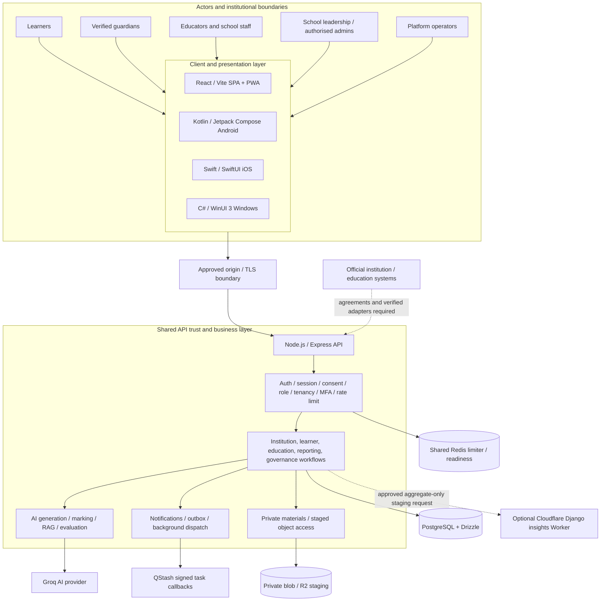
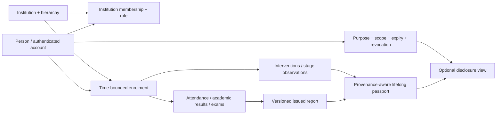
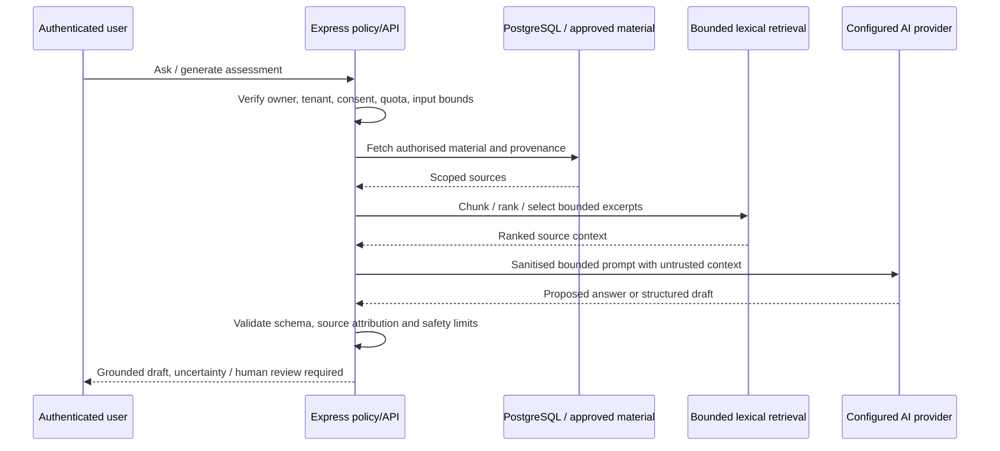

# CABO Learning Hub — System Architecture

> **Architecture baseline:** 23 November 2026 · **Source:** repository `main` inspection (source and documentation), not a live environment audit.
>
> **Product:** CABO Learning Hub is a **connected education and lifelong development platform**, not just an LMS. It integrates institution operations, learner journeys, assessment, family engagement, support, intelligence, responsible AI and controlled future opportunity sharing.
>
> **Status legend:** **Present in main** = source exists; **gated / pilot** = shipped code requires flags, approvals, or migration; **candidate** = code/design under evaluation or on an unmerged branch; **target** = future architecture. Source presence does **not** prove runtime operation, CI success, production readiness, legal clearance or official education authority.

## 1. Architecture at a glance

The system is a **multi-client, modular monorepo**, primarily backed by a single Express API and relational data model. Distinct policy and workflow modules exist inside the API; they are **not independently deployed microservices**. Native clients use the same protected contracts. A narrow experimental Django/Cloudflare processing service is intentionally separate from the primary API.

**Critical boundary:** no client, institution role, feature flag, external API or LLM response independently grants authority to access a learner. API checks and institutional provenance remain mandatory at each read and mutation. Diagram arrows indicate architectural relationships, **not that every external integration is live**.

## 2. Repository topology and deployment units

| Component | Source of truth | Function | Status / boundary |
| --- | --- | --- | --- |
| Web UI | `artifacts/training-platform` | React SPA, Vite, responsive role portals, PWA/installability | Present in main |
| Core HTTP API | `artifacts/api-server/src/app.ts`, `routes/`, `lib/`, `middlewares/` | Express 5, domain routes, policy engines, health, server-side protection, optional static SPA hosting | Present in main; operational verification separate |
| Shared model | `lib/db/src/schema`, `lib/db/migrations` | PostgreSQL/Drizzle schema and additive migrations | Present; production schema/bootstrap and recovery require validation |
| API schemas / client packages | `lib/api-spec`, `lib/api-zod`, `lib/api-client-react` | Shared API contracts and generated client types | Present |
| Auth integration | `lib/replit-auth-web`, `artifacts/api-server/src/routes/auth.ts`, `nativeAuth.ts` | Browser OIDC/session and native authentication contracts | Present; identity migration/MFA release gates |
| Android | `native-apps/android` | Kotlin / Compose, native journeys, release and test workflows | Present; signed publication/device acceptance not implied |
| iOS | `native-apps/ios` | Swift / SwiftUI, native journeys and verification workflows | Present; signing/device acceptance not implied |
| Windows | `native-apps/windows` | WinUI 3, shared core, tests, installer tooling | Present; signed distribution/installer acceptance not implied |
| Optional insights processor | `services/cloudflare-django-worker` | Narrow aggregate-only advisory insights, authenticated server-to-server | Staging-only and disabled by default |
| Automation / CI | `.circleci/config.yml`, `.github/workflows`, `scripts` | Node checks, code safety, platform builds, installer/release candidates and smoke tools | Pipeline definitions exist; check latest runs before release |
| Engineering and legal evidence | `docs/engineering`, `docs/legal` | Release gates, reviews, country compliance, trust and operational guides | Evidence register, not certification |

The monorepo is managed with **pnpm workspaces**. Express can serve the compiled SPA in a same-origin deployment. The repository also documents Render-oriented execution and **gated Cloudflare migration candidates**; do not equate a built candidate with a deployed replacement. Infrastructure details: [deployment](DEPLOYMENT.md), [operations](INFRA_OPERATIONS_RUNBOOK.md), [infrastructure gaps](PLATFORM_INFRASTRUCTURE_GAPS.md).

## 3. Domains and bounded contexts

These are **logical modules** within one service and shared database unless stated otherwise.

| Domain | Primary capabilities | Representative implementation |
| --- | --- | --- |
| Identity, organisation and jurisdiction | OIDC / sessions; memberships and invitations; school, district and management hierarchy; country applicability; administrator verification | `routes/auth.ts`, `organizations.ts`, `institutionSetup.ts`, `managementHierarchy.ts`, `lib/hierarchyPolicy.ts` |
| Admissions and mobility | Institution applications and transfer workspace, admission evidence, trust and verification rules; life-stage transitions | `routes/admissions.ts`, `admissionEvidence.ts`, `lib/admissionsTrustPolicy.ts`, `lib/passportTrustPolicy.ts` |
| Education delivery | Training modules, content, curriculum/framework definitions, materials and study support | `routes/training.ts`, `hubModules.ts`, `educationFrameworks.ts`, `storage.ts` |
| Academic operations | Academic records, class/subject links, exams, assessment papers, question bank, timetables, attendance, progression, report issuance | `routes/academic.ts`, `assessmentPapers.ts`, `assessmentQuestionBank.ts`, `writtenExams.ts`, `timetable.ts`, `attendanceSync.ts`, `reportIssuance.ts` |
| Learner success | Longitudinal journey, school stages, interventions, individual development plans and progress signals | `routes/learnerJourney.ts`, `schoolStages.ts`, `learnerSupport.ts`, `developmentPlans.ts`, `schoolProgression.ts` |
| Families and wellbeing | Verified guardian relationship, scoped child progress, notifications, accountability, school support and moderated class chat policy | `routes/guardianVerification.ts`, `guardianProgress.ts`, `nativeParent.ts`, `accountability.ts`, `classChat.ts` |
| Intelligence and analytics | Academic intelligence, leadership dashboards, command-centre views, health and performance telemetry | `routes/academicIntelligence.ts`, `educationCommand.ts`, `workerInsights.ts`, `mlops.ts` |
| AI assistance | Document-grounded Q&A, exam generation/marking, personalization, observability, provider quota, retrieval evaluation | `lib/aiCompletion.ts`, `aiProviderPolicy.ts`, `materialRetrieval.ts`, `ragLexical.ts`, `mlopsEvaluation.ts` |
| Long-term identity and opportunity | Lifelong learning passport, issuance/source trust, career portfolio, opt-in opportunity disclosure | `routes/lifelongPassport.ts`, `passportTrustRoutes.ts`, `potential.ts`, `educationTalent.ts` |
| Platform operations and commercial controls | Admin consoles, privacy requests, AI credits, payment webhook handling, storage quotas, notification preferences and delivery | `routes/privacy.ts`, `aiCredits.ts`, `notificationPreferences.ts`, `health.ts`, `lib/r2BudgetLedger.ts` |

**Do not confuse route existence with completion:** complete operational flows still require valid migrations, integrations, multi-account tests, data agreements and approved deployment. Native feature parity is tracked separately in [native feature parity](../native-apps/FEATURE_PARITY.md). See [role portals](ROLE_BASED_PORTALS.md), [governance hierarchy](GOVERNANCE_HIERARCHY.md) and [platform guide](PLATFORM_GUIDE.md).

## 4. Identity, tenancy, consent and cross-border trust

1. **Authenticate** through server-validated browser session/OIDC or native PKCE/session flow; validate expiry, revocation and origin. Production issuer configuration is an explicit rollout decision, not implied by a login button.
2. **Authorize each operation** using the caller's server-resolved identity, organisation membership, assigned role, ownership, school affiliation and permitted record scope. A platform administrator's broad listing permission must not silently become institution membership.
3. **Verify guardian relationships** per school and current enrolment before disclosing a child’s progress, results or notifications; require appropriate lawful basis and jurisdiction-specific clearance.
4. **Protect privileged actions** with reviewed MFA and recent-authentication requirements; feature-gated code is insufficient until enforcement, recovery and revocation are proven.
5. **Fail closed** on missing school-data release clearance, inactive feature gates, expired permissions, invalid consent or unverifiable issuer provenance.
6. **Audit consequential access and transitions** with redacted events and request correlation, not unbounded child data in logs or provider telemetry.

The target hierarchy spans **platform governance** and, only under lawful delegated authority, education structures such as national → province → district → circuit → institution → grade → class. These are **different authority domains**; being a platform superadmin does not grant government powers. Country-specific rules for South Africa and Botswana need enforceable, institution-approved agreements and legal review. No approved official national learner register or cross-border EMIS integration is established by source code.

**Isolation model:** today the primary design uses application-level organisation and object checks, plus narrow storage ACLs and audit policies. Do **not** claim database row-level security (RLS), external penetration testing or independently proven cross-tenant isolation without evidence. Negative two-tenant, guardian and role-escalation integration tests are release blockers. See [privacy and consent](PRIVACY_AND_CONSENT.md), [passport trust](PASSPORT_TRUST_BOUNDARIES.md), [country requirements](legal/ZA_BW_LIVE_SCHOOL_RELEASE_GATES.md).

## 5. Data architecture and provenance

**Primary system of record:** PostgreSQL with Drizzle schema packages in `lib/db/src/schema`. Separate schema modules cover organisations, identity, education, exam content, support, admissions, school stages, reports, guardian verification, AI usage, notification outbox, profiles, audits and trust layers. Migration ordering is declared in `lib/db/migrations/ORDER`.

These entities show the **conceptual information lifecycle**, not a claim that every edge is a database foreign key or every version/issuer is cryptographically certified.

- Separate **person identity** from institution enrolment and from authorised guardian relationships.
- Treat school-issued results, AI interpretations, self-reported evidence and future verified credentials as **different evidence grades**.
- Model institution transfer as source-aware, time-bounded transitions with provenance, not unrestricted row reassignment.
- Keep private learning materials outside public web storage; maintain opaque keys, owner/tenant access and deletion/retention decisions.
- Require reviewed additive migration paths, migration rehearsal, tested backups and restore, and idempotent durable processing before live institutional onboarding.
- An isolated **synthetic demo dataset** is not an authoritative education dataset and must not be used to imply a real school onboarding.

See [national target architecture](NATIONAL_EDUCATION_ARCHITECTURE.md), [lifelong passport](LIFELONG_PASSPORT_FOUNDATION.md), [institution mobility](INSTITUTION_TRANSFERS_AND_GUARDIANS.md) and [database/data quality standards](BI_DATA_QUALITY_AND_ANALYTICS_STANDARD.md).

## 6. AI, retrieval and responsible decision-making

- **Implemented foundations:** document text extraction, batch generation, question/exam workflows, evidence-limited material Q&A, lexical retrieval (BM25/local and PostgreSQL lexical foundation), source checks, quota handling, output validation, AI telemetry and reproducible retrieval evaluation.
- **Not an autonomous educational authority:** assessment grading, interventions, safeguarding decisions, report issuance, progression and psychological interpretations require authorised human review and an appeal/correction trail.
- **Provider posture:** Groq-backed flows are documented; alternate provider routing may exist in PRs or feature flags, but must never be presented as active without confirming runtime configuration. Do not leak learner identifiers, raw sensitive documents or secrets into prompts, telemetry or callbacks.
- **Known trade-offs:** lexical retrieval has paraphrase/semantic recall limits; synthetic offline Hit@k is not production answer accuracy; hallucinations and malicious uploaded text remain threats. Any future embeddings/vector infrastructure requires measured benefit, data protection, cost ceilings and deletion design.
- **Safety:** reject instructions embedded in uploaded material, disallow unverified cross-tenant retrieval, moderate peer interaction, establish escalation ownership for safeguarding, and do not auto-diagnose or send distress alerts without a reviewed human response process.

References: [RAG pipeline](RAG_PIPELINE.md), [evaluation](AI_RAG_EVALUATION.md), [engineering AI/RAG](engineering/AI_RAG.md), [native MLOps](NATIVE_MLOPS.md).

## 7. Messaging, object storage and auxiliary execution

**Object storage:** repository adapters include private-blob access and **gated R2 staging**, quarantine/approval, opaque keys, storage quotas and budget-ledger checks. The existence of an R2 adapter does not prove full production malware scanning, retention compliance or reconciled bucket billing.

**Background work:** notification outbox/dispatcher and QStash signed material-preview callbacks are separate reliability concerns from synchronous HTTP requests. Verify recipient eligibility and consent when dispatching, idempotency keys, retries, dead-letter handling, signature validation, cancellation, redaction and end-to-end delivery. A queue definition or email policy is **not evidence that delivery worked**.

**Redis:** shared throttling/readiness support is represented in `lib/redisRateLimit.ts` and `redisReadiness.ts`. Validate production configuration and fail-safe behavior; do not infer a general-purpose distributed cache or full task queue.

**Django/Cloudflare Worker:** the narrow `services/cloudflare-django-worker` implementation only accepts **coded, aggregate-only, de-identified** learning metrics for deterministic advisory labels, protected by a server-to-server bearer secret. It is opt-in, staging-only and **not** a second full backend, persistence tier, child-record store or unrestricted AI worker.

See [notification outbox](NOTIFICATION_OUTBOX_RUNBOOK.md), [R2 safety](r2-staging-cost-controls.md), [private blob](PRIVATE_BLOB_ROLLOUT.md), [QStash preview](QSTASH_MATERIAL_PREVIEW.md).

## 8. Client contracts and deployment topology

- **Web:** responsive React/Vite role-specific routes, PWA manifest/service worker and optional Express same-origin SPA hosting. Sensitive user data and API responses must not be indiscriminately service-worker cached.
- **Android:** Kotlin/Jetpack Compose app, native screens and test/release workflows; release signing, test devices and store distribution require evidence.
- **iOS:** Swift/SwiftUI app with native accounts and role views; protect session isolation across sign-out, session invalidation and account switch. Mac/Xcode/device verification remains an independent gate.
- **Windows:** C#/WinUI 3 app, common native core, tests and installer candidate; end-user signed release verification remains separate.
- **API contracts:** server remains authoritative; preserve compatibility, version and validate DTOs, test native role/guardian boundaries, never assume all UI surfaces offer identical features.

**Deployment choices:** current repository docs reference Render for the Node/React pilot, Neon/PostgreSQL, Upstash Redis/Blob/QStash and candidate Cloudflare Pages/Containers/R2/Worker assets. They are **distinct deployable or proposed resources**, not evidence all are online or interchangeable. A static Cloudflare Pages upload alone cannot replace authenticated API/DB/AI services. Cloudflare full-stack migration must preserve origin, cookies, callbacks, durable storage, migrations and rollback, and remain behind its explicit release gate until independently tested.

## 9. End-to-end example flows

### Learner asks about uploaded material
1. Authenticated learner opens material.
2. API verifies owner and any applicable consent/storage release gate.
3. Approved document text is bounded and retrieved through a lexical ranking path.
4. AI receives only authorised bounded context; output citations are checked.
5. API returns a draft; human or learner can inspect original evidence. No unsolicited cross-user retrieval.

### Guardian reviews a child’s progress
1. Guardian signs in and selects a linked learner.
2. API verifies relationship, institution, current enrolment and release eligibility.
3. Progress is read only from permitted institutional sources.
4. Response is scoped, minimised and non-cacheable where sensitive; failed checks return denial rather than a global list.

### School publishes an assessment/report
1. Staff member acts within school/course permissions.
2. Questions, marking and evidence pass appropriate review.
3. School-issued artifact records who approved it and relevant source/version.
4. Corrections produce traceable revisions; guardian notice is evaluated against current notification consent.
5. A lifelong passport may reference evidence but cannot silently upgrade a draft AI mark to a verified credential.

### Learner changes institution
1. Authorised admission/transfer flow verifies originating and receiving authority.
2. Institution and country rules define minimum transferable information.
3. Identity continuity is maintained; prior institutional provenance is preserved.
4. New enrolment and new guardian/school visibility are independently evaluated. No blanket cross-school record visibility.

## 10. Operational, security and release gates

| Control area | Minimum acceptance required before live child/institution data |
| --- | --- |
| Identity | Approved production IdP; tested MFA/step-up, session revocation, native/web account isolation |
| Tenancy | Negative two-institution IDOR tests for *every* sensitive domain, guardian links and administrator paths |
| Privacy/legal | South Africa/Botswana applicability, child processing/guardian authority, DPAs, retention, cross-border processor mapping, DPIA and owner/legal approval |
| Data | Reproducible migrations, backup **restore drill**, traceable corrections, provenance/transfer tests and strict synthetic/live isolation |
| AI | Measured quality, source-grounding, prompts treated as untrusted, safety evaluations, quotas, human review and escalation |
| Storage / delivery | Private blob two-account tests, quarantine/delete, cost guardrails, outbox replay/retry and notification consent |
| Observability | Sanitised request/exception logs, health/readiness checks, monitoring and actionable alert delivery, tested incident/rollback runbooks |
| Client releases | Real device checks, accessibility, signed Android/Windows release tests and appropriate iOS signing/distribution |
| Deployment | Staging E2E, independent security review, approved production secrets/origins, documented rollback, explicit owner approval |

**Production readiness is not established by this document.** Consult the latest [production audit](engineering/PRODUCTION_COMPLETION_AUDIT.md), [release readiness](engineering/RELEASE_READINESS.md), [master backlog](engineering/MASTER_COMPLETION_BACKLOG.md) and current GitHub CI before making any deployment claim. Some November 22 audit findings predate files or PRs added on November 23; refresh evidence rather than silently upgrading statuses.

## 11. Target evolution (not current deployment claims)

1. **Release discipline first:** reliable tenant-isolation integration testing, identity/MFA rollout, verified country/child-data clearance, privacy-safe logs and tested recovery.
2. **Institution onboarding at scale:** verified school registry/onboarding, import validation, deduplication, approved transfers and source-attributed canonical records.
3. **Operational resilience:** durable event/outbox lifecycle, cache and query budgets, capacity planning, service-level objectives and approved observability.
4. **Education intelligence:** supported, explainable learner-success feedback and aggregated district reporting with privacy thresholds and accountable human interventions.
5. **Interoperability:** formal DBE/PED/EMIS, Botswana education authority or tertiary interfaces **only after** documented agreements, approved schemas and legal authority.
6. **Adult opportunity ecosystem:** candidate-initiated, time-limited and revocable employer disclosures after age, organisation and data provenance controls are verified.

Avoid premature microservice decomposition or unapproved national data aggregation. Scale the current modular monolith based on measured workload, security boundaries, fault isolation and operational capacity.

## 12. Potential & Opportunity subarchitecture (formerly the entire document)

The pre-existing `docs/ARCHITECTURE.md` described only the **Potential & Opportunity** consent model. That model is retained here as a specific bounded context:

- `potential_profiles`: voluntary user-owned profile.
- `potential_evidence`: self-reported skills, projects, achievement and reflections.
- `career_opportunities`: organisation-published opportunities.
- `employer_access_requests`: purpose, scope, status and expiry.
- `employer_access_audit`: creation/decision/read events.

**Consent transitions:** pending → approved (short-lived, previously seven-day access window) / denied; approved → revoked / expired. Access checks must evaluate current approval, purpose/scope, eligibility, role and expiry **at read time** and audit the read. The server derives subject identity from the signed-in actor, never a caller-supplied `userId`. A mere employer request confers **no access**. School marks, childhood observations, sensitive reflections and private grades are never automatically included in the professional disclosure view.

**Limitations:** verified paid-company eligibility, age/guardian policy, tamper-evident immutable audits, recall of already downloaded disclosures, attached evidence verification and independent AI scoring are not implied. Employer access should remain disabled unless privacy/age/organisation controls are independently accepted.

## 13. Maintenance rules and documentation map

Whenever a feature or PR changes a domain, update this file **and** the relevant operational runbook. Record the exact source paths, database migrations, API contracts, feature flags, tenant/privacy threats, evidence, rollout and rollback. Mark each new subsystem **present / gated / candidate / target**; never convert a design document or merged PR into an unqualified “production ready” statement.

Start with [platform identity](PLATFORM_IDENTITY.md), [national target](NATIONAL_EDUCATION_ARCHITECTURE.md), [role portals](ROLE_BASED_PORTALS.md), [admissions](ADMISSIONS_REGISTRATION_AND_MOBILITY_ZA_BW.md), [security](engineering/SECURITY_REVIEW.md), [RAG](RAG_PIPELINE.md), [native apps](../native-apps/README.md), [infrastructure](INFRA_OPERATIONS_RUNBOOK.md) and [release gates](EIGHT_WORKSTREAM_RELEASE_GATES.md).
