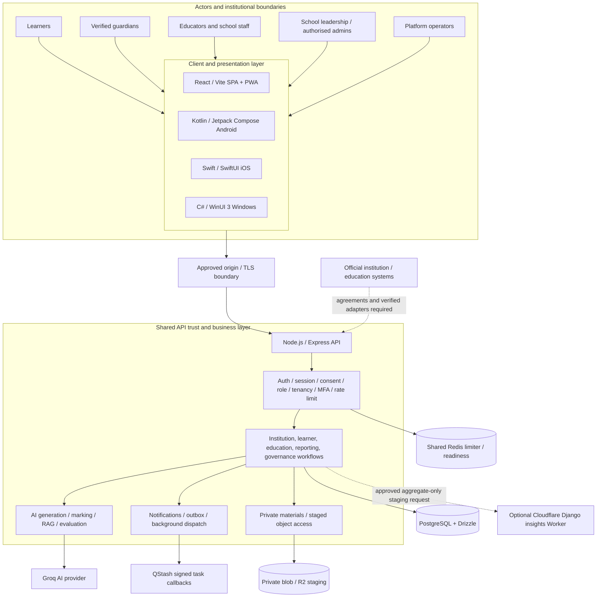
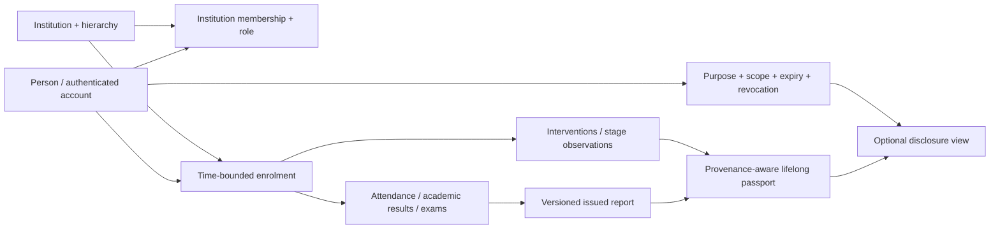
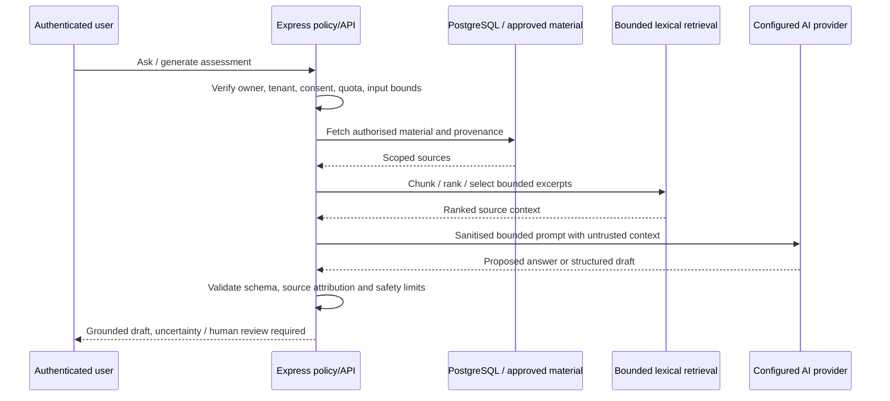
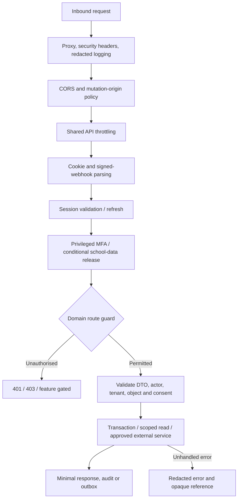
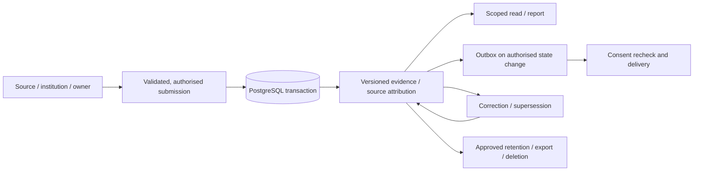
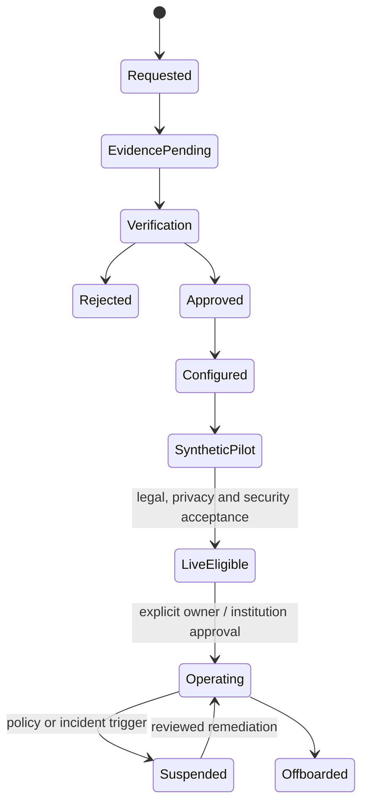
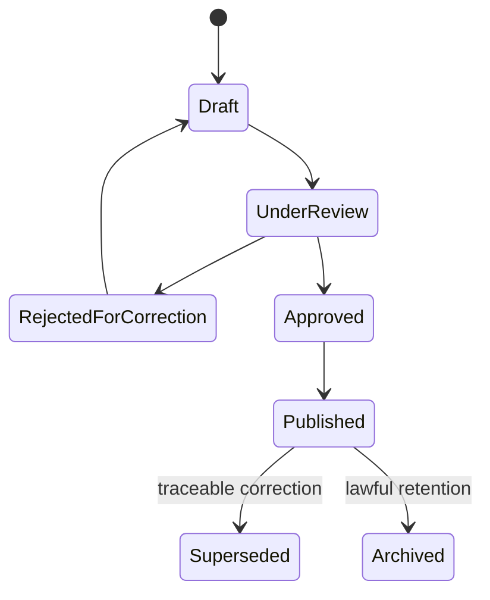
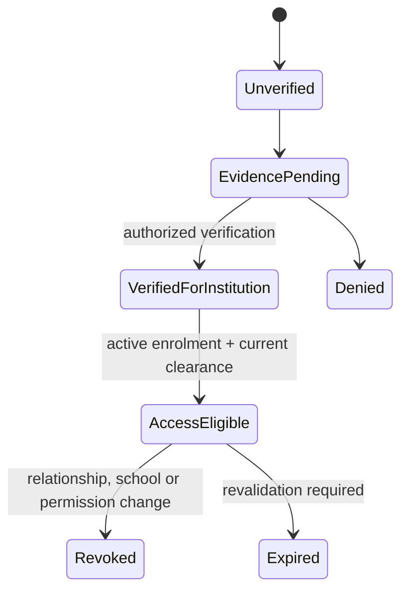
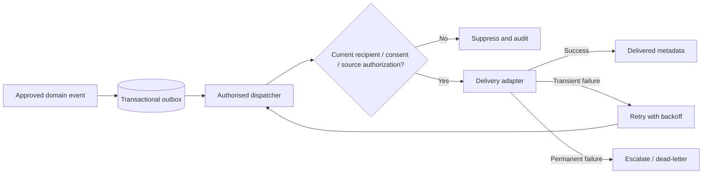
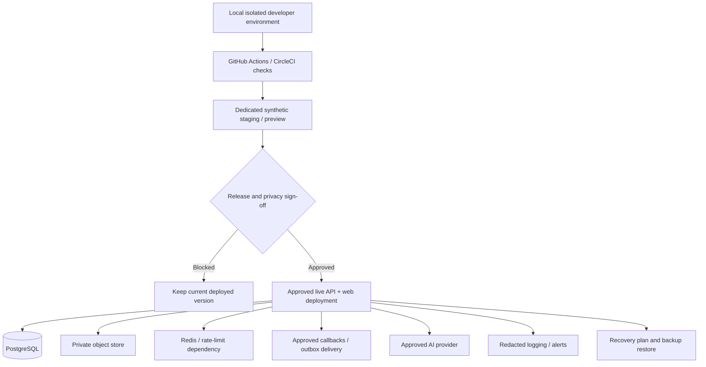

# CABO Learning Hub — System Architecture

> **Architecture baseline:** 23 November 2026 · **Source:** repository `main` inspection (source and documentation), not a live environment audit.
>
> **Product:** CABO Learning Hub is a **connected education and lifelong development platform**, not just an LMS. It integrates institution operations, learner journeys, assessment, family engagement, support, intelligence, responsible AI and controlled future opportunity sharing.
>
> **Status legend:** **Present in main** = source exists; **gated / pilot** = shipped code requires flags, approvals, or migration; **candidate** = code/design under evaluation or on an unmerged branch; **target** = future architecture. Source presence does **not** prove runtime operation, CI success, production readiness, legal clearance or official education authority.

## 1. Architecture at a glance

The system is a **multi-client, modular monorepo**, primarily backed by a single Express API and relational data model. Distinct policy and workflow modules exist inside the API; they are **not independently deployed microservices**. Native clients use the same protected contracts. A narrow experimental Django/Cloudflare processing service is intentionally separate from the primary API.



**Critical boundary:** no client, institution role, feature flag, external API or LLM response independently grants authority to access a learner. API checks and institutional provenance remain mandatory at each read and mutation. Diagram arrows indicate architectural relationships, **not that every external integration is live**.

## 2. Repository topology and deployment units

| Component | Source of truth | Function | Status / boundary |
| --- | --- | --- | --- |
| Web UI | `artifacts/training-platform` | React SPA, Vite, responsive role portals, PWA/installability | Present in main |
| Core HTTP API | `artifacts/api-server/src/app.ts`, `routes/`, `lib/`, `middlewares/` | Express 5, domain routes, policy engines, health, server-side protection, optional static SPA hosting | Present in main; operational verification separate |
| Shared model | `lib/db/src/schema`, `lib/db/migrations` | PostgreSQL/Drizzle schema and additive migrations | Present; production schema/bootstrap and recovery require validation |
| API schemas / client packages | `lib/api-spec`, `lib/api-zod`, `lib/api-client-react` | Shared API contracts and generated client types | Present |
| Auth integration | `lib/replit-auth-web`, `artifacts/api-server/src/routes/auth.ts`, `nativeAuth.ts` | Browser OIDC/session and native authentication contracts | Present; identity migration/MFA release gates |
| Android | `native-apps/android` | Kotlin / Compose, native journeys, release and test workflows | Present; signed publication/device acceptance not implied |
| iOS | `native-apps/ios` | Swift / SwiftUI, native journeys and verification workflows | Present; signing/device acceptance not implied |
| Windows | `native-apps/windows` | WinUI 3, shared core, tests, installer tooling | Present; signed distribution/installer acceptance not implied |
| Optional insights processor | `services/cloudflare-django-worker` | Narrow aggregate-only advisory insights, authenticated server-to-server | Staging-only and disabled by default |
| Automation / CI | `.circleci/config.yml`, `.github/workflows`, `scripts` | Node checks, code safety, platform builds, installer/release candidates and smoke tools | Pipeline definitions exist; check latest runs before release |
| Engineering and legal evidence | `docs/engineering`, `docs/legal` | Release gates, reviews, country compliance, trust and operational guides | Evidence register, not certification |

The monorepo is managed with **pnpm workspaces**. Express can serve the compiled SPA in a same-origin deployment. The repository also documents Render-oriented execution and **gated Cloudflare migration candidates**; do not equate a built candidate with a deployed replacement. Infrastructure details: [deployment](DEPLOYMENT.md), [operations](INFRA_OPERATIONS_RUNBOOK.md), [infrastructure gaps](PLATFORM_INFRASTRUCTURE_GAPS.md).

## 3. Domains and bounded contexts

These are **logical modules** within one service and shared database unless stated otherwise.

| Domain | Primary capabilities | Representative implementation |
| --- | --- | --- |
| Identity, organisation and jurisdiction | OIDC / sessions; memberships and invitations; school, district and management hierarchy; country applicability; administrator verification | `routes/auth.ts`, `organizations.ts`, `institutionSetup.ts`, `managementHierarchy.ts`, `lib/hierarchyPolicy.ts` |
| Admissions and mobility | Institution applications and transfer workspace, admission evidence, trust and verification rules; life-stage transitions | `routes/admissions.ts`, `admissionEvidence.ts`, `lib/admissionsTrustPolicy.ts`, `lib/passportTrustPolicy.ts` |
| Education delivery | Training modules, content, curriculum/framework definitions, materials and study support | `routes/training.ts`, `hubModules.ts`, `educationFrameworks.ts`, `storage.ts` |
| Academic operations | Academic records, class/subject links, exams, assessment papers, question bank, timetables, attendance, progression, report issuance | `routes/academic.ts`, `assessmentPapers.ts`, `assessmentQuestionBank.ts`, `writtenExams.ts`, `timetable.ts`, `attendanceSync.ts`, `reportIssuance.ts` |
| Learner success | Longitudinal journey, school stages, interventions, individual development plans and progress signals | `routes/learnerJourney.ts`, `schoolStages.ts`, `learnerSupport.ts`, `developmentPlans.ts`, `schoolProgression.ts` |
| Families and wellbeing | Verified guardian relationship, scoped child progress, notifications, accountability, school support and moderated class chat policy | `routes/guardianVerification.ts`, `guardianProgress.ts`, `nativeParent.ts`, `accountability.ts`, `classChat.ts` |
| Intelligence and analytics | Academic intelligence, leadership dashboards, command-centre views, health and performance telemetry | `routes/academicIntelligence.ts`, `educationCommand.ts`, `workerInsights.ts`, `mlops.ts` |
| AI assistance | Document-grounded Q&A, exam generation/marking, personalization, observability, provider quota, retrieval evaluation | `lib/aiCompletion.ts`, `aiProviderPolicy.ts`, `materialRetrieval.ts`, `ragLexical.ts`, `mlopsEvaluation.ts` |
| Long-term identity and opportunity | Lifelong learning passport, issuance/source trust, career portfolio, opt-in opportunity disclosure | `routes/lifelongPassport.ts`, `passportTrustRoutes.ts`, `potential.ts`, `educationTalent.ts` |
| Platform operations and commercial controls | Admin consoles, privacy requests, AI credits, payment webhook handling, storage quotas, notification preferences and delivery | `routes/privacy.ts`, `aiCredits.ts`, `notificationPreferences.ts`, `health.ts`, `lib/r2BudgetLedger.ts` |

**Do not confuse route existence with completion:** complete operational flows still require valid migrations, integrations, multi-account tests, data agreements and approved deployment. Native feature parity is tracked separately in [native feature parity](../native-apps/FEATURE_PARITY.md). See [role portals](ROLE_BASED_PORTALS.md), [governance hierarchy](GOVERNANCE_HIERARCHY.md) and [platform guide](PLATFORM_GUIDE.md).

## 4. Identity, tenancy, consent and cross-border trust

1. **Authenticate** through server-validated browser session/OIDC or native PKCE/session flow; validate expiry, revocation and origin. Production issuer configuration is an explicit rollout decision, not implied by a login button.
2. **Authorize each operation** using the caller's server-resolved identity, organisation membership, assigned role, ownership, school affiliation and permitted record scope. A platform administrator's broad listing permission must not silently become institution membership.
3. **Verify guardian relationships** per school and current enrolment before disclosing a child’s progress, results or notifications; require appropriate lawful basis and jurisdiction-specific clearance.
4. **Protect privileged actions** with reviewed MFA and recent-authentication requirements; feature-gated code is insufficient until enforcement, recovery and revocation are proven.
5. **Fail closed** on missing school-data release clearance, inactive feature gates, expired permissions, invalid consent or unverifiable issuer provenance.
6. **Audit consequential access and transitions** with redacted events and request correlation, not unbounded child data in logs or provider telemetry.

The target hierarchy spans **platform governance** and, only under lawful delegated authority, education structures such as national → province → district → circuit → institution → grade → class. These are **different authority domains**; being a platform superadmin does not grant government powers. Country-specific rules for South Africa and Botswana need enforceable, institution-approved agreements and legal review. No approved official national learner register or cross-border EMIS integration is established by source code.

**Isolation model:** today the primary design uses application-level organisation and object checks, plus narrow storage ACLs and audit policies. Do **not** claim database row-level security (RLS), external penetration testing or independently proven cross-tenant isolation without evidence. Negative two-tenant, guardian and role-escalation integration tests are release blockers. See [privacy and consent](PRIVACY_AND_CONSENT.md), [passport trust](PASSPORT_TRUST_BOUNDARIES.md), [country requirements](legal/ZA_BW_LIVE_SCHOOL_RELEASE_GATES.md).

## 5. Data architecture and provenance

**Primary system of record:** PostgreSQL with Drizzle schema packages in `lib/db/src/schema`. Separate schema modules cover organisations, identity, education, exam content, support, admissions, school stages, reports, guardian verification, AI usage, notification outbox, profiles, audits and trust layers. Migration ordering is declared in `lib/db/migrations/ORDER`.



These entities show the **conceptual information lifecycle**, not a claim that every edge is a database foreign key or every version/issuer is cryptographically certified.

- Separate **person identity** from institution enrolment and from authorised guardian relationships.
- Treat school-issued results, AI interpretations, self-reported evidence and future verified credentials as **different evidence grades**.
- Model institution transfer as source-aware, time-bounded transitions with provenance, not unrestricted row reassignment.
- Keep private learning materials outside public web storage; maintain opaque keys, owner/tenant access and deletion/retention decisions.
- Require reviewed additive migration paths, migration rehearsal, tested backups and restore, and idempotent durable processing before live institutional onboarding.
- An isolated **synthetic demo dataset** is not an authoritative education dataset and must not be used to imply a real school onboarding.

See [national target architecture](NATIONAL_EDUCATION_ARCHITECTURE.md), [lifelong passport](LIFELONG_PASSPORT_FOUNDATION.md), [institution mobility](INSTITUTION_TRANSFERS_AND_GUARDIANS.md) and [database/data quality standards](BI_DATA_QUALITY_AND_ANALYTICS_STANDARD.md).

## 6. AI, retrieval and responsible decision-making



- **Implemented foundations:** document text extraction, batch generation, question/exam workflows, evidence-limited material Q&A, lexical retrieval (BM25/local and PostgreSQL lexical foundation), source checks, quota handling, output validation, AI telemetry and reproducible retrieval evaluation.
- **Not an autonomous educational authority:** assessment grading, interventions, safeguarding decisions, report issuance, progression and psychological interpretations require authorised human review and an appeal/correction trail.
- **Provider posture:** Groq-backed flows are documented; alternate provider routing may exist in PRs or feature flags, but must never be presented as active without confirming runtime configuration. Do not leak learner identifiers, raw sensitive documents or secrets into prompts, telemetry or callbacks.
- **Known trade-offs:** lexical retrieval has paraphrase/semantic recall limits; synthetic offline Hit@k is not production answer accuracy; hallucinations and malicious uploaded text remain threats. Any future embeddings/vector infrastructure requires measured benefit, data protection, cost ceilings and deletion design.
- **Safety:** reject instructions embedded in uploaded material, disallow unverified cross-tenant retrieval, moderate peer interaction, establish escalation ownership for safeguarding, and do not auto-diagnose or send distress alerts without a reviewed human response process.

References: [RAG pipeline](RAG_PIPELINE.md), [evaluation](AI_RAG_EVALUATION.md), [engineering AI/RAG](engineering/AI_RAG.md), [native MLOps](NATIVE_MLOPS.md).

## 7. Messaging, object storage and auxiliary execution

**Object storage:** repository adapters include private-blob access and **gated R2 staging**, quarantine/approval, opaque keys, storage quotas and budget-ledger checks. The existence of an R2 adapter does not prove full production malware scanning, retention compliance or reconciled bucket billing.

**Background work:** notification outbox/dispatcher and QStash signed material-preview callbacks are separate reliability concerns from synchronous HTTP requests. Verify recipient eligibility and consent when dispatching, idempotency keys, retries, dead-letter handling, signature validation, cancellation, redaction and end-to-end delivery. A queue definition or email policy is **not evidence that delivery worked**.

**Redis:** shared throttling/readiness support is represented in `lib/redisRateLimit.ts` and `redisReadiness.ts`. Validate production configuration and fail-safe behavior; do not infer a general-purpose distributed cache or full task queue.

**Django/Cloudflare Worker:** the narrow `services/cloudflare-django-worker` implementation only accepts **coded, aggregate-only, de-identified** learning metrics for deterministic advisory labels, protected by a server-to-server bearer secret. It is opt-in, staging-only and **not** a second full backend, persistence tier, child-record store or unrestricted AI worker.

See [notification outbox](NOTIFICATION_OUTBOX_RUNBOOK.md), [R2 safety](r2-staging-cost-controls.md), [private blob](PRIVATE_BLOB_ROLLOUT.md), [QStash preview](QSTASH_MATERIAL_PREVIEW.md).

## 8. Client contracts and deployment topology

- **Web:** responsive React/Vite role-specific routes, PWA manifest/service worker and optional Express same-origin SPA hosting. Sensitive user data and API responses must not be indiscriminately service-worker cached.
- **Android:** Kotlin/Jetpack Compose app, native screens and test/release workflows; release signing, test devices and store distribution require evidence.
- **iOS:** Swift/SwiftUI app with native accounts and role views; protect session isolation across sign-out, session invalidation and account switch. Mac/Xcode/device verification remains an independent gate.
- **Windows:** C#/WinUI 3 app, common native core, tests and installer candidate; end-user signed release verification remains separate.
- **API contracts:** server remains authoritative; preserve compatibility, version and validate DTOs, test native role/guardian boundaries, never assume all UI surfaces offer identical features.

**Deployment choices:** current repository docs reference Render for the Node/React pilot, Neon/PostgreSQL, Upstash Redis/Blob/QStash and candidate Cloudflare Pages/Containers/R2/Worker assets. They are **distinct deployable or proposed resources**, not evidence all are online or interchangeable. A static Cloudflare Pages upload alone cannot replace authenticated API/DB/AI services. Cloudflare full-stack migration must preserve origin, cookies, callbacks, durable storage, migrations and rollback, and remain behind its explicit release gate until independently tested.

## 9. End-to-end example flows

### Learner asks about uploaded material
1. Authenticated learner opens material.
2. API verifies owner and any applicable consent/storage release gate.
3. Approved document text is bounded and retrieved through a lexical ranking path.
4. AI receives only authorised bounded context; output citations are checked.
5. API returns a draft; human or learner can inspect original evidence. No unsolicited cross-user retrieval.

### Guardian reviews a child’s progress
1. Guardian signs in and selects a linked learner.
2. API verifies relationship, institution, current enrolment and release eligibility.
3. Progress is read only from permitted institutional sources.
4. Response is scoped, minimised and non-cacheable where sensitive; failed checks return denial rather than a global list.

### School publishes an assessment/report
1. Staff member acts within school/course permissions.
2. Questions, marking and evidence pass appropriate review.
3. School-issued artifact records who approved it and relevant source/version.
4. Corrections produce traceable revisions; guardian notice is evaluated against current notification consent.
5. A lifelong passport may reference evidence but cannot silently upgrade a draft AI mark to a verified credential.

### Learner changes institution
1. Authorised admission/transfer flow verifies originating and receiving authority.
2. Institution and country rules define minimum transferable information.
3. Identity continuity is maintained; prior institutional provenance is preserved.
4. New enrolment and new guardian/school visibility are independently evaluated. No blanket cross-school record visibility.

## 10. Operational, security and release gates

| Control area | Minimum acceptance required before live child/institution data |
| --- | --- |
| Identity | Approved production IdP; tested MFA/step-up, session revocation, native/web account isolation |
| Tenancy | Negative two-institution IDOR tests for *every* sensitive domain, guardian links and administrator paths |
| Privacy/legal | South Africa/Botswana applicability, child processing/guardian authority, DPAs, retention, cross-border processor mapping, DPIA and owner/legal approval |
| Data | Reproducible migrations, backup **restore drill**, traceable corrections, provenance/transfer tests and strict synthetic/live isolation |
| AI | Measured quality, source-grounding, prompts treated as untrusted, safety evaluations, quotas, human review and escalation |
| Storage / delivery | Private blob two-account tests, quarantine/delete, cost guardrails, outbox replay/retry and notification consent |
| Observability | Sanitised request/exception logs, health/readiness checks, monitoring and actionable alert delivery, tested incident/rollback runbooks |
| Client releases | Real device checks, accessibility, signed Android/Windows release tests and appropriate iOS signing/distribution |
| Deployment | Staging E2E, independent security review, approved production secrets/origins, documented rollback, explicit owner approval |

**Production readiness is not established by this document.** Consult the latest [production audit](engineering/PRODUCTION_COMPLETION_AUDIT.md), [release readiness](engineering/RELEASE_READINESS.md), [master backlog](engineering/MASTER_COMPLETION_BACKLOG.md) and current GitHub CI before making any deployment claim. Some November 22 audit findings predate files or PRs added on November 23; refresh evidence rather than silently upgrading statuses.

## 11. Target evolution (not current deployment claims)

1. **Release discipline first:** reliable tenant-isolation integration testing, identity/MFA rollout, verified country/child-data clearance, privacy-safe logs and tested recovery.
2. **Institution onboarding at scale:** verified school registry/onboarding, import validation, deduplication, approved transfers and source-attributed canonical records.
3. **Operational resilience:** durable event/outbox lifecycle, cache and query budgets, capacity planning, service-level objectives and approved observability.
4. **Education intelligence:** supported, explainable learner-success feedback and aggregated district reporting with privacy thresholds and accountable human interventions.
5. **Interoperability:** formal DBE/PED/EMIS, Botswana education authority or tertiary interfaces **only after** documented agreements, approved schemas and legal authority.
6. **Adult opportunity ecosystem:** candidate-initiated, time-limited and revocable employer disclosures after age, organisation and data provenance controls are verified.

Avoid premature microservice decomposition or unapproved national data aggregation. Scale the current modular monolith based on measured workload, security boundaries, fault isolation and operational capacity.

## 12. Potential & Opportunity subarchitecture (formerly the entire document)

The pre-existing `docs/ARCHITECTURE.md` described only the **Potential & Opportunity** consent model. That model is retained here as a specific bounded context:

- `potential_profiles`: voluntary user-owned profile.
- `potential_evidence`: self-reported skills, projects, achievement and reflections.
- `career_opportunities`: organisation-published opportunities.
- `employer_access_requests`: purpose, scope, status and expiry.
- `employer_access_audit`: creation/decision/read events.

**Consent transitions:** pending → approved (short-lived, previously seven-day access window) / denied; approved → revoked / expired. Access checks must evaluate current approval, purpose/scope, eligibility, role and expiry **at read time** and audit the read. The server derives subject identity from the signed-in actor, never a caller-supplied `userId`. A mere employer request confers **no access**. School marks, childhood observations, sensitive reflections and private grades are never automatically included in the professional disclosure view.

**Limitations:** verified paid-company eligibility, age/guardian policy, tamper-evident immutable audits, recall of already downloaded disclosures, attached evidence verification and independent AI scoring are not implied. Employer access should remain disabled unless privacy/age/organisation controls are independently accepted.

## 13. Maintenance rules and documentation map

Whenever a feature or PR changes a domain, update this file **and** the relevant operational runbook. Record the exact source paths, database migrations, API contracts, feature flags, tenant/privacy threats, evidence, rollout and rollback. Mark each new subsystem **present / gated / candidate / target**; never convert a design document or merged PR into an unqualified “production ready” statement.

Start with [platform identity](PLATFORM_IDENTITY.md), [national target](NATIONAL_EDUCATION_ARCHITECTURE.md), [role portals](ROLE_BASED_PORTALS.md), [admissions](ADMISSIONS_REGISTRATION_AND_MOBILITY_ZA_BW.md), [security](engineering/SECURITY_REVIEW.md), [RAG](RAG_PIPELINE.md), [native apps](../native-apps/README.md), [infrastructure](INFRA_OPERATIONS_RUNBOOK.md) and [release gates](EIGHT_WORKSTREAM_RELEASE_GATES.md).


---

## 14. Architecture decisions, constraints and non-functional requirements

The runtime is a **modular monolith**, not a fleet of microservices. The API is one Express deployment with domain-owned routers, shared policies and a transactional relational database. The optional Cloudflare Django worker is a narrowly bounded advisory processor. Do not convert the diagram into invented separate services.

| Decision | Today / direction | Reason and trade-off |
| --- | --- | --- |
| Node.js / Express 5 API | Single modular application | Centralizes shared authorization and database transactions; a failure can affect multiple domains |
| PostgreSQL and Drizzle | Source of truth and shared schema packages | Referential integrity and transactional operations; needs disciplined migrations and query budgets |
| Web React/Vite | Responsive SPA/PWA | Wide reach and one deployable UI; must isolate sensitive authenticated content from offline caching |
| Android, iOS, Windows native | Separate Kotlin, Swift, WinUI 3 applications | Platform-specific access/UX; multiplied contract, release and account isolation testing |
| OIDC/session-centered auth | Server-validated sessions; native auth flows | Centralized identity but issuer changes and MFA deployment require rehearsed migration |
| Groq and lexical retrieval | Server-side bounded generation and source-aware Q&A | Lower infrastructure cost; lexical retrieval misses semantically distant paraphrases |
| Outbox and signed callbacks | Gated asynchronous tasks and notifications | Supports decoupled delivery, but idempotency, retry, dead-letter recovery and current consent must be demonstrated |
| Private object adapters | Signed/owned access, staging and quotas | Limits direct file exposure; malware/retention/deletion and billing reconciliation require release review |
| Cloudflare migration | Candidate; explicit deny-by-default release controls | May change deployment topology; a static frontend alone cannot replace the authenticated backend |
| Synthetic demos | Explicit isolated testing | Avoids unauthorised live learner records; must never accidentally enable synthetic identities on live environments |

### Quality-attribute acceptance

| Attribute | Acceptance evidence; no unverified numeric promises |
| --- | --- |
| Security | Cross-school IDOR and role escalation tests for every sensitive domain; independent review and penetration assessment |
| Privacy | Approved child-data purposes, guardian evidence, POPIA/Botswana processor mapping, deletion/retention decisions |
| Performance | Synthetic load profiles, p50/p95/p99 latency, connection-pool utilization, slow-query plans, material size budgets |
| Availability | Dependency fault injection, readiness probes, incident runbook and tested recovery |
| Consistency | Concurrent write tests, transaction boundaries, idempotency and report/ledger correction behaviour |
| Maintainability | Domain ownership, documented contracts, reviewed schema changes and CI reproducibility |
| Accessibility | WCAG 2.2 AA audits including keyboard, screen reader, zoom, mobile and native device testing |
| Cost | Provider quota, AI credit, Redis, DB, job and storage usage thresholds with owner-visible budget alerts |

No approved SLO, RPO, RTO, throughput ceiling or national-scale capacity target is verified by repository inspection. Define and test these before selling an uptime/capacity guarantee.

## 15. HTTP lifecycle and API contract ownership

The actual request order in `artifacts/api-server/src/app.ts` is architecturally significant:

1. Configure trusted proxy based on the explicit `TRUST_PROXY_HOPS` setting.
2. Attach privacy-limited Pino HTTP logging, baseline response security headers and allowlisted CORS.
3. Validate browser mutation origins and apply the shared API rate limiter **before** normal body parsing and session lookups.
4. Parse cookies; preserve byte-exact JSON for QStash material preview and Paystack signature verification callbacks.
5. Parse JSON/forms, resolve and refresh the browser/native session as applicable, and attach heartbeat.
6. Apply privileged MFA guard and **optional** `CABO_COUNTRY_PILOT_ENFORCEMENT` middleware.
7. Dispatch signed internal callback handlers, then the consolidated domain router in `routes/index.ts`.
8. Handle malformed or oversized JSON, followed by a generic exception boundary and opaque request reference.
9. Optionally serve the compiled React SPA from the same server, without routing unknown `/api/*` requests to HTML.



**Important:** this is a description of the API composition, not proof that every individual route is correct. The router-level security audit must check all endpoints and every nested object ownership decision.

### Domain route inventory

All paths in this table are source files inside `artifacts/api-server/src/routes/`, not a claim that all features are activated on a deployed instance.

| Ownership | Routers | Mandatory control |
| --- | --- | --- |
| Platform identity and user settings | `auth.ts`, `nativeAuth.ts`, `rolePortals.ts`, `profile.ts`, `privacy.ts` | Authenticated identity and user-owned private data |
| Organisations and hierarchy | `organizations.ts`, `institutionSetup.ts`, `institutionRecords.ts`, `managementHierarchy.ts` | Institution membership, invitation acceptance, delegated administrative authority |
| Learning delivery | `training.ts`, `hubModules.ts`, `educationFrameworks.ts`, `storage.ts` | Material owner, school assignment, approved file state |
| Assessments | `writtenExams.ts`, `assessmentPapers.ts`, `assessmentQuestionBank.ts`, `academicExamLinks.ts` | Authorised assessor/class; published evidence and approved grading |
| Academic and school operations | `academic.ts`, `attendanceSync.ts`, `timetable.ts`, `schoolStages.ts`, `schoolProgression.ts` | Institution, period, academic year, grade/class and issuer |
| Student success and institutional intelligence | `learnerJourney.ts`, `learnerSupport.ts`, `developmentPlans.ts`, `academicIntelligence.ts`, `educationCommand.ts` | Learner support confidentiality and aggregate/report thresholds |
| Family and accountability | `guardianVerification.ts`, `guardianProgress.ts`, `nativeParent.ts`, `notificationPreferences.ts`, `classChat.ts`, `accountability.ts` | Current verified relationship, safety escalation and controlled recipients |
| Admissions and opportunity | `admissions.ts`, `admissionEvidence.ts`, `potential.ts`, `educationTalent.ts` | Authorised institutional action and candidate-controlled disclosure |
| Passport and trust | `lifelongPassport.ts`, `passportTrustRoutes.ts`, `reportCards.ts`, `reportIssuance.ts` | Issuer evidence, versioning and prohibited silent credential upgrade |
| AI, processing and billing | `learnerAiProfile.ts`, `mlops.ts`, `workerInsights.ts`, `aiCredits.ts` | AI consent, quotas, attribution, financial webhook verification |
| Infrastructure and pilot | `health.ts`, `demoShowcase.ts`, `demoStatus.ts`, `demoAdmissionsInbox.ts`, `qstashMaterialPreview.ts` | Diagnostic disclosure minimization, explicit testing isolation, signed callbacks |

For each new endpoint record: HTTP method, public path, authenticated actor, source of effective organisation ID, role, object owner, Zod schema, response shape, feature flags, rate limiter, audit, idempotency policy, error cases, and **negative** cross-user and cross-school tests.

## 16. Relational data model and ownership

The exported schema index is `lib/db/src/schema/index.ts`. These source modules are **not** separate database servers.

| Data family | Representative schema modules | Invariant |
| --- | --- | --- |
| Accounts, tenant roles, educational structure | `auth`, `organizations`, `managementHierarchy`, `courseStaff` | Person identity is not organisation membership; privileges are time/context limited |
| Course materials and academic records | `training`, `materialUploadBlobs`, `academic`, `academicExamLinks`, `educationFrameworks` | Restrict by owner/institution/assignment and track material approval |
| Exams and quality | `writtenExams`, `assessmentQuestionBank`, `assessmentPapers`, `schoolReportIssuance` | Separate draft/marking/approved issuance; preserve historical corrections |
| School events and development | `schoolOperations`, `schoolTimetable`, `schoolProgressionEvents`, `learnerJourney`, `schoolStages`, `learnerSupport` | No silent reassignment across school year, school or issuing authority |
| Guardian and school trust | `guardianVerification`, `institutionDataClearances`, `institutionSetup` | Relationship verification and jurisdiction eligibility at access time |
| Longitudinal and adult sharing | `lifelongPassport`, `passportTrustLayers`, `talentPassport`, `potential`, `admissions` | Self-report, school-issued and formally verified evidence remain different |
| Governance and interaction | `platformAudit`, `notificationConsent`, `notificationOutbox`, `accountability`, `classChat`, `profiles` | Approved recipients, revocation, moderation and record retention |
| AI and accounting | `aiMetrics`, `mlops`, `learnerAiProfile`, `aiCredits` | Per-person/tenant attribution, bounded spend and event uniqueness |

### Lifecycle of a sensitive record



**Read:** resolve actor → institutional/record policy → constrain SQL predicate to tenant and owner → project minimum fields → bound pagination and redaction.

**Write:** validate Zod input → resolve effective tenant on the server → authorize → apply transactional state change and audit → enqueue post-commit action using a reliable outbox. External failure must not falsely report that a school result was rolled back when it was committed.

**Transfer:** retain previous issuer attribution and source history; new school membership does not automatically authorize reading previous private records.

**Deletion:** determine legal retention; revoke access and pending shares; delete or archive source, derived indexes and blob according to reviewed policy; preserve a minimal lawful audit trail.

**Migration:** additive backwards-compatible changes first; test against isolated representative schema; inspect `lib/db/migrations/ORDER`, expected locks and old/new version compatibility; take backup and rehearse restore. The repository's earlier development base-schema `drizzle-kit push` means an empty-to-current production migration bootstrap must be independently proven.

## 17. Role and tenant access-control contract

The matrix is the **required security target**, not evidence every endpoint has passed integration testing.

| Workflow | Learner | Verified guardian | Staff/assessor | Institution leadership | Platform operator |
| --- | --- | --- | --- | --- | --- |
| Personal study assistant | Own approved material | Not automatically | Assigned material | Delegated scope | No implicit routine content access |
| Learner academic progress | Own permitted data | Verified dependent, per-school | Assigned class | Audited school scope | Exception only, logged |
| Attendance / timetable | Own context | Child-scoped | Assigned grade/class | Institution scope | Audited administration |
| Examination publication | Assigned attempt | Read permitted published child results | Review and approve by assigned duty | Defined institutional issuer | No forged educational authority |
| Support and safeguarding | Appropriate self-service | Verified and purpose-limited | Assigned professionals | Case-authorised leadership | Restricted escalated audit path |
| Admissions / transfers | Self application | Approved dependent | Delegated desk role | Institution decision authority | No invented regulator powers |
| Public/private career profile | Age-appropriate opt-in | No impersonation | No default access | No silent student disclosure | Platform policy only |
| Aggregate education command view | No other-child visibility | Own dependent only | Appropriate cohort | Aggregated institution scope | Legally approved aggregation scope |

A valid login must never act as a shortcut for permission to view **any** record in the same school. Negative tests: outsider ID guessing, school A vs B, revoked member, guardian with stale verification, wrong enrolment, platform list ≠ institution membership, expired share, unapproved data release, changed role mid-session and replayed background task.

## 18. Domain lifecycle state diagrams

### Institution onboarding (target contract)



Not all states have corresponding production persistence today. In particular, synthetic demonstrations and draft verification code are **not** official institution registration.

### Assessment and report lifecycle



AI marking and generated questions must never be silently promoted into institutional certification. Preserve reviewer, source and version.

### Guardian disclosure



### Adult opportunity disclosure

Pending → approved for a specific purpose/scope and expiry → revoked or expired. Re-evaluate the grant for **every read**. Previously downloaded information cannot be clawed back; no employer gets child academic data by default.

## 19. AI / RAG architecture in engineering detail

### Input trust boundaries

1. Authenticate the caller, determine authorized material IDs and verify current profile/AI consent.
2. Validate the question/assessment input size and allowed operation, enforce request and provider/credit quotas.
3. Read approved material using an owner-scoped storage adapter or cache. File text and OCR output are **data**, never trusted instructions.
4. Split and rank bounded chunks. Local BM25 and a gated PostgreSQL lexical index provide lexical retrieval foundations; neither proves semantic retrieval quality or a production vector database.
5. Add only approved minimal learner preferences where explicitly opted in. Do not use inferred sensitive characteristics to determine access or marks.
6. Issue a bounded provider call with explicit time/retry limits and an allowed model; parse and validate the returned JSON/schema where required.
7. Verify cited excerpts are supported by selected passages. Reject unsupported answers, wrong question indices, invalid marks or malformed outputs.
8. Store permitted usage, redacted quality telemetry and audit references; do not log the private prompt/body by default.
9. Return draft feedback with citations and uncertainty. Staff review remains mandatory for consequential assessments.

```mermaid
sequenceDiagram
  actor U as Learner / authorised educator
  participant API as Express owner/consent policy
  participant DB as PostgreSQL and material store
  participant RET as Lexical retrieval
  participant LLM as Server-side AI provider
  U->>API: Question or assessment request
  API->>API: Auth, tenant, credit and consent gates
  API->>DB: Owner-scoped approved text
  DB-->>API: Source/version evidence
  API->>RET: Chunk and rank, bounded context
  RET-->>API: Evidence excerpts
  API->>LLM: Bounded text / structured response format
  LLM-->>API: Proposed answer or marks
  API->>API: Schema and citation checks; telemetry
  API-->>U: Supported draft / error requiring review
```

**Failure semantics:** missing consent → denied; source unavailable → no ungrounded answer; provider quota/timeout → explicit retriable or unavailable response, not fabricated results; malformed citations → reject/fallback; spend exhausted → fail before expensive work; learner safety issue → human-owned escalation workflow, **not an autonomous diagnosis**.

**Evaluation plan:** source retrieval Hit@k/MRR, supported-answer precision, abstention quality, mark-agreement against educators, harmful-output refusal, prompt-injection tests, latency/cost by task, and cross-owner retrieval isolation. Synthetic lexical evaluation cannot certify real curricula, languages or neurodiverse accessibility.

## 20. Storage, queues, notifications and payments

### Storage states

**Target upload pipeline:** requested → size/MIME validation → isolated private staging → malware/content review → consent and ownership approval → indexed/available → retained, revoked or deleted. Object paths must be opaque and links should be short-lived and audience-scoped. No R2 adapter or database quota alone proves anti-malware scanning or policy-compliant deletion.

### Notification outbox

The repository contains `lib/notificationOutbox.ts`, `lib/currentNotificationAuthorization.ts`, `lib/notificationEligibility.ts`, `lib/outboxDispatcher.ts` and associated schemas. The intended workflow is:



Outbox enabled flags, recipient encryption, idempotency, delivery provider credentials, and live delivery logs must be verified independently. Never include grades, national identifiers or attachments in plaintext notifications; use authenticated deep links where needed.

### Payments and AI credits

`routes/aiCredits.ts` provides balance/plan/credit ledger contracts and a hosted Paystack integration candidate. Payment callbacks require exact-body signature verification and idempotent provider references; only server-confirmed settlement can change a paid ledger. The code explicitly requires provider secret and owner-set pricing before genuine purchase is available. Demo top-ups are limited to an isolated testing database. **Do not claim live revenue or completed payment-provider certification** based on the route's existence.

### Optional processing and external authorities

The Cloudflare Django Worker is staging-only, guarded by a secret and approved aggregate-only inputs. National education, university and government exchange points remain *contract-dependent future integrations*. Never send child records to a worker or third party merely because a technical connector exists.

## 21. Detailed cross-platform contract and state handling

| Surface | Source | Local state and security requirement | Release evidence required |
| --- | --- | --- | --- |
| Web/PWA | `artifacts/training-platform/src` | Server remains source of truth; no private API response in public SW caches; role navigation is not authorization | Browser role/guard E2E, accessibility, auth renew/logout |
| Android | `native-apps/android` | Native API layer with token/session isolation, account-switch reset and correct owner-scoped response parsing | Unit and instrumented checks, signed APK/AAB, devices and OS coverage |
| iOS | `native-apps/ios` | Swift session and role state; clear account caches on logout, 401, failed refresh and next login | Xcode build, Swift tests, supported device versions and signing |
| Windows | `native-apps/windows` | WinUI 3 views, .NET core and safe session persistence; prevent stale school state crossing logins | xUnit, packaged installer, signed distribution/upgrade/uninstall testing |
| Web install experience | `docs/INSTALLABLE_APP_RELEASE.md` | PWA installation is **not** equivalent to native store distribution | Icon/manifest/offline-safe tests and platform-specific install review |

Server contract changes should document additive fields, versioned breaking changes, native minimum supported client and rollout order (backward-compatible API first, then clients). An outdated native client must not bypass new privacy/consent rules.

## 22. Infrastructure environments, recovery and deployment



This depicts **environment separation as a requirement**; do not infer an existing fully working production deployment from the diagram. The checked-in deployment documents describe Render pilots, PostgreSQL/Neon, Upstash services, and gated Cloudflare candidates. An infrastructure migration must prove session/cookie continuity, DB compatibility, signed callbacks, storage ownership, secrets, monitoring, data location and rollback.

### CI and release responsibility

- `.github/workflows/verify.yml`, `code-safety.yml`: core checks and code-safety definitions.
- `native-android-debug.yml` and `native-android-release.yml`: emulator/build and release-candidate paths, **not** automatic Play Store publication.
- `native-ios-verify.yml`: iOS verification definition, not a guarantee of signed/App Store release.
- `native-windows-verify.yml` and `windows-release.yml`: Windows verification/packaging path.
- `.circleci/config.yml`: main verification, security/deployment steps, optional Django staging actions and guardrails.
- `scripts/render-build.sh`, `render-start.sh` and test/smoke scripts: documented Render-associated build and runtime helpers.

For every release retain: version and commit, exact environment, CI run URLs, test output, reviewed migration plan, backup/restore evidence, privacy assessment, independent security review, owner approval, smoke checks and rollback decision.

### Failure-mode register

| Failure | Expected behaviour | Verification |
| --- | --- | --- |
| PostgreSQL unavailable | Readiness 503; private data never served from an unsafe bypass | Disable DB in isolated staging; check error privacy |
| Redis unavailable | Apply documented safe limiter fallback; no unlimited expensive endpoint bypass | Dependency fault test and alert |
| AI provider quota/outage | Clear unavailable response, bounded retry/fallback, no invented marks | Simulated 429/5xx/timeout |
| R2/blob unavailable | Keep records inaccessible if cannot safely read; no public bucket fallback | Storage read/write fault tests |
| Outbox dispatcher restart | Replay safely without duplicate end-user notices | Crash-before/after-send tests |
| Paystack callback replay | Do not credit balance twice | Repeat valid signed event |
| Native session expires | Clear all account-scoped state; reject stale in-flight replies | Two-user device switch tests |
| School membership revoked | Immediately remove restricted data visibility; revalidate queued notices | Role revocation concurrent read test |
| Migration partially applied | Stop rollout; recover from validated migration state, not manual destructive drop | Staging interrupted migration drill |
| Data exposure suspected | Revoke credentials and access, preserve sanitized evidence, invoke incident review | Tabletop incident exercise |

### Monitoring dimensions

Use low-cardinality route categories, HTTP outcomes, database query latency, pool wait, queue age, outbox delivery delay, retry/dead-letter counts, AI tokens/cost/quality, object storage quota, private blob failures, failed authorization trends, and release-level error changes. Never tag metrics with child's name, school-record body, secret or free-text query. Health endpoints `/api/healthz` and `/api/readyz` are currently wired through a router mounted at `/api`; readiness checks DB and optionally Redis. No external uptime alert integration is proven here.

## 23. Privacy, safeguarding and compliance control points

**Data classes:** public platform content; institutional operational data; restricted learner records; highly sensitive child/family/admissions evidence; private study material; authentication and financial metadata; AI prompts/model outputs. Each class needs explicit access, permitted processors, retention, deletion and incident handling.

**South Africa / Botswana:** platform access must respect actual institution authority and legal review, not an assumed unified national permissions model. POPIA, Botswana data protection obligations and institutional contracts require a documented applicability matrix and processor list. Official school integrations and data transfers cannot be activated merely by importing a CSV.

**Safeguarding:** class chat, reports and wellbeing alerts must use adult accountability, evidence minimization, moderation escalation and abuse prevention. A suicide/mental-health risk inference is not a diagnosis. Do not automatically send inferred mental-health content to unrelated recipients or make irreversible automated decisions without vetted policy and clinical/safeguarding governance.

**Future talent/scouting:** school sports performance, leaderboards and external scouts must not expose identified children by default. Consent, privacy thresholds, verified adult institutions, age transitions, anti-profiling and purpose restrictions are release prerequisites.

## 24. Known gaps and production gates, classified

**Present in source:** substantial web and native clients; Express domain routes; Drizzle schema; AI/Q&A and assessment paths; country/guardian policy helpers; RAG evaluation foundation; notification outbox; signing/release workflow definitions.

**Gated or unverified:** production identity migration and privileged MFA enforcement; country pilot and school-data release; child-safe private storage retention and malware processes; transaction notice dispatch; payment provider onboarding; current production deployment; complete load/error budgets; end-to-end release-artifact distribution.

**Explicitly not established:** operational official South African/Botswana education-system integration; government accreditation; cryptographically verified nationwide passport; automatic real-world institution adoption; full cross-tenant penetration assessment; independent legal sign-off; tested national-scale performance.

### Minimum evidence before live institutional use

1. Production IdP, MFA and all role/session termination paths tested.
2. Two-institution and two-guardian negative authorization suite including revocations.
3. Legal and child-data approvals, data processing contracts, retention and geographic processor decisions.
4. Every required migration applied to isolated staging with successful restore drill.
5. Trusted report issuance, academic corrections and outbox/notification consent tested end to end.
6. AI safety, document provenance, grading moderation and source-grounding benchmark approved.
7. Device-level web, Android, iOS and Windows regression for supported release channels.
8. Dependency failure, alert delivery, incident response and rollback rehearsal.
9. Signed artefacts and authenticated deployment with verified smoke tests.
10. Human release sign-off recorded; production data remains untouched otherwise.

### Maintenance and architecture drift

Every module change should update its schema/route map, public contract, actor/tenant authorization, feature flags, external processors, event delivery, observability and rollback section. Avoid duplicating unverified roadmap promises as actual infrastructure. Use the [engineering release audit](engineering/PRODUCTION_COMPLETION_AUDIT.md) and current CI to refresh status after merge.

## 25. Documentation review method and exclusions

**Inspected for this version:** repository file tree, `app.ts` and `routes/index.ts`, database schema index, route examples for organisations, written exams and AI credits, `health.ts`, identity middleware, lexical retrieval, notification outbox, native source paths, CircleCI and GitHub Actions definitions, and existing engineering/legal/design documents. These establish architecture **from source**, not live operational results.

**Not performed:** complete static review of every route and schema field; exhaustive API schema extraction; signed release validation; live database or Cloudflare/Render/Neon inspection; full CI reruns; independent legal or penetration audit; physical device testing. Therefore diagrams and matrices are architectural contracts and evidence-scoped descriptions, never unqualified certification.

