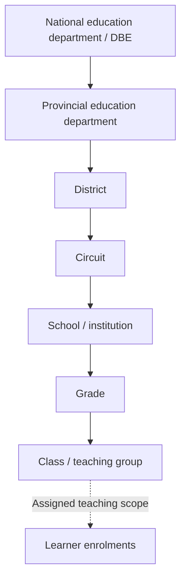
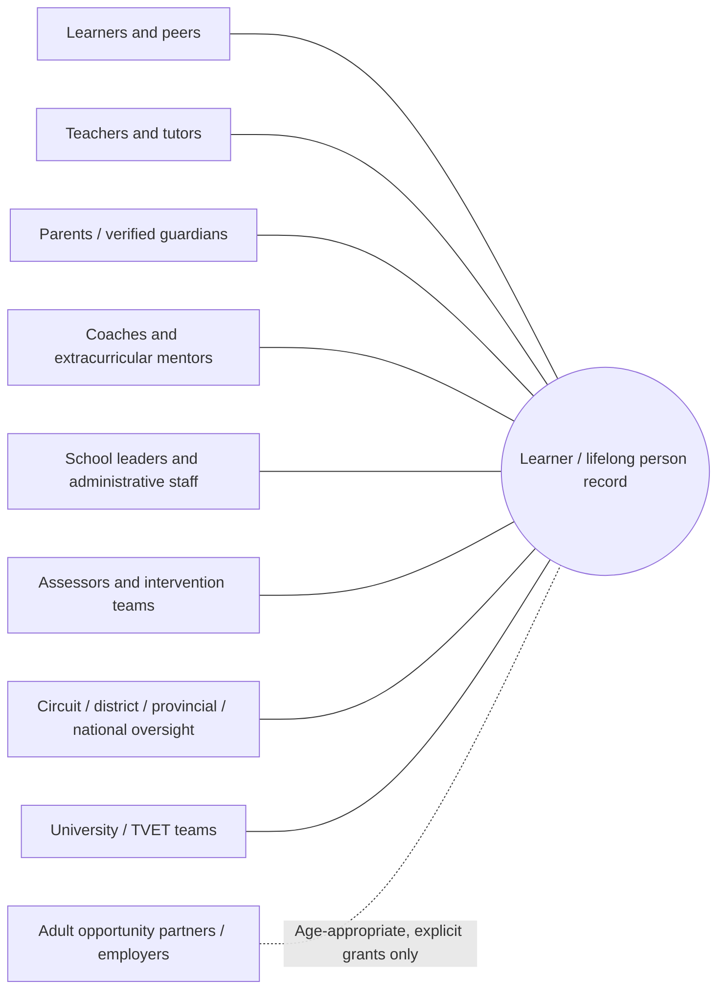
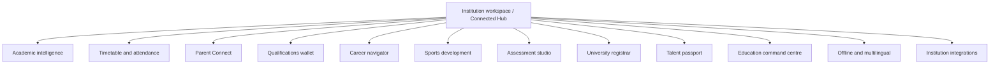
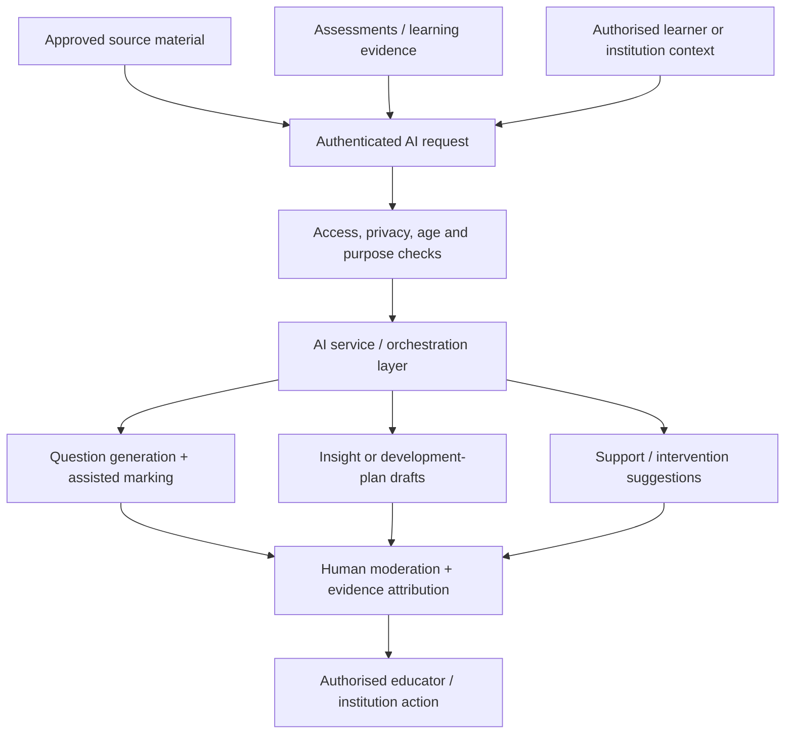
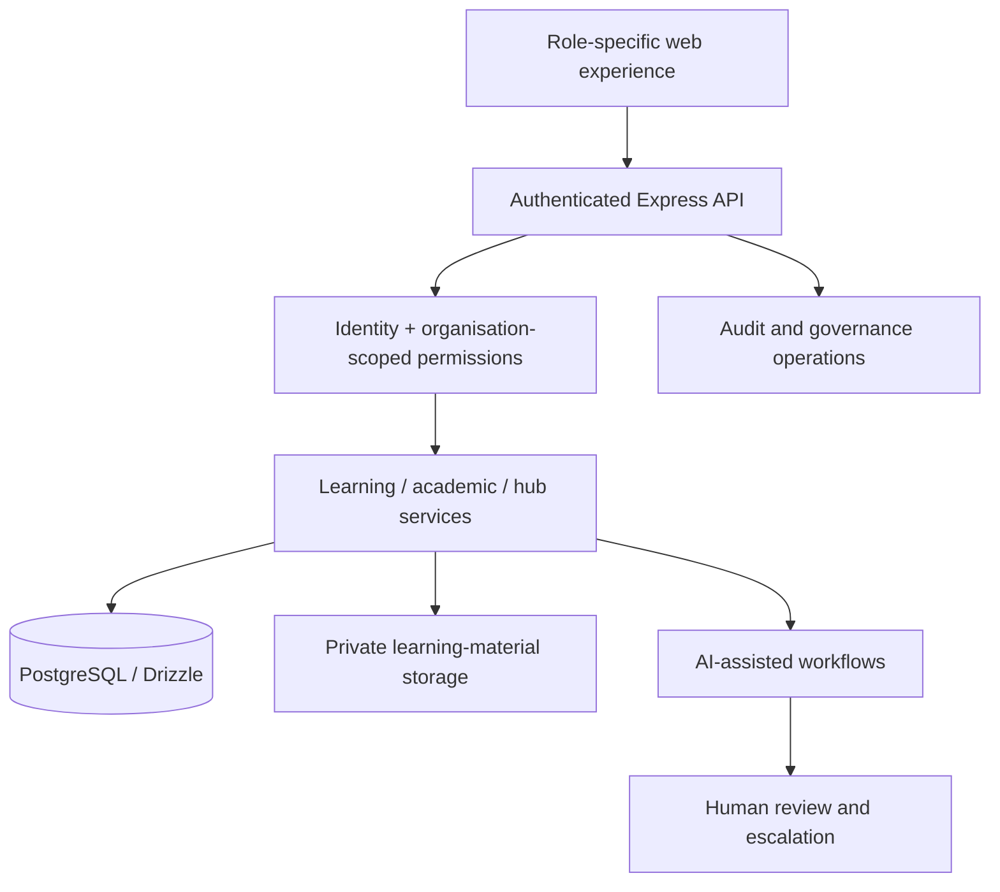
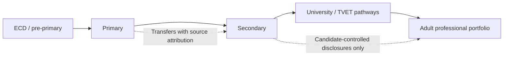

# CABO Learning Hub — Multi-Layer Platform Architecture

> **Positioning:** Connected Education and Lifelong Development Platform — **not merely an LMS**.  
> **Status:** Architecture combines implemented/prototype foundations, gated pilots and target design. See [delivery evidence](PHASES_1_TO_4_DELIVERY_REGISTER.md).  
> **Source of authority:** [Platform identity](PLATFORM_IDENTITY.md), [national architecture](NATIONAL_EDUCATION_ARCHITECTURE.md), [connected hub modules](CONNECTED_HUB_SPRINTS.md).

## Why a simple learner → teacher diagram is insufficient

CABO is built around interconnected **communities of people**, a **delegated institutional hierarchy**, a **learner-centred longitudinal identity**, operational modules, and a responsible AI layer. These are independent dimensions: the number of communities is **not** the same as the number of administrative levels or the number of product modules.

The product's complete target architecture should answer four questions:
1. Who belongs to the learner's support network, and what relationships are verified?
2. Which institution or government authority can act on which data?
3. Which specialist module produces evidence, insight or action?
4. Which AI-assisted recommendation is permissible, reviewable and attributable?

## 1. National governance hierarchy — seven explicitly documented levels

This is a **target governance structure**, not an assertion that CABO operates an official national learner registry. A higher position in the hierarchy does **not** grant unrestricted learner-record access. Each scope needs verified institutional affiliation, delegated roles, least privilege, a valid purpose and auditability.

For universities and TVET providers, registrar, programme, module and semester logic must be modelled separately. A university is not just a large school.

## 2. Communities and role ecosystems — overlapping relationships

The product identity documents multiple populations, not a single rigid community count. The following map shows **nine stakeholder communities as a documentation grouping**, not nine verified product tenants or an official canonical numbered taxonomy.

This diagram represents **potential relationships**, not default sharing permissions. In particular, a guardian invitation alone does not authorise grade access; employers do not gain access to childhood records or psychological information; authorities may only see information within verified, purpose-specific scopes.

### Relationship design

- **One person, multiple enrolments:** each enrolment is tied to an institution and period; transfers preserve provenance.
- **Evidence layers:** source-submitted evidence, AI interpretation and verified institutional achievements must remain separate.
- **Guardian relationships:** require verification and distinct time-limited permissions.
- **Role grants:** must be bound to institution, class, subject or operation as appropriate.
- **Transfers:** must avoid allowing old institutions to continue accessing records outside their lawful authority.

## 3. Six product pillars

| Pillar | Purpose | Example |
| --- | --- | --- |
| Learning and assessment | Materials, exercises, written exams | Source-grounded AI-assisted marking |
| Learner journey and development | Longitudinal milestones and evidence | Progression and achievements |
| Educator and family support | Human intervention and coordination | Guardian flows, support cases |
| Institutional operations and governance | Attendance, academic and leadership workflows | Scoped dashboards and reporting |
| Responsible intelligence | Evidence-linked assistance | Insight drafts, model governance |
| Pathways and opportunity | Tertiary, qualifications and adult careers | Gated applications and disclosures |

These are **pillars**, not the full feature inventory.

## 4. Twelve interconnected institutional modules

The [connected hub sprint reference](CONNECTED_HUB_SPRINTS.md) describes the following modules:

Module visibility does **not** imply complete delivery. Some features are registry entries, partial workflows or feature-gated pilots; signed credentials, official integrations, fully operational native apps, and accredited assessments remain subject to separate delivery gates.

## 5. AI is a cross-cutting intelligence layer — not one chatbot

**Implementation evidence:** The repository documents AI-assisted assessment and marking, development-plan workflows and limited model-health/MLOps support. Current application AI uses Groq only; Hugging Face fallback, cross-module orchestration and national-scale intelligence are not implemented as live provider-routing features.

### AI responsibility model

- **Grounding:** use authorised source content and preserve provenance.
- **Interpretation:** separate probabilistic AI conclusions from recorded school evidence.
- **Human oversight:** human reviewers own consequential academic and support decisions.
- **Privacy:** do not let one role's prompt retrieve another learner's private data.
- **Operational safety:** measure provider errors, failure modes, costs and model quality before promising failover or availability.
- **Fairness:** avoid opaque learner ranking, automated diagnoses and unverified suitability predictions.

## 6. Technical components and data boundaries

The currently documented workspace uses **React / TypeScript**, an **Express API**, **PostgreSQL / Drizzle**, private object storage for materials and server-side AI calls.

**Native Android/Kotlin, iOS and desktop:** these are explicit cross-platform delivery workstreams. Their release readiness, device parity and secure offline behaviour are not established by a web README alone.

## 7. Journey across life stages

This is a **continuity aspiration**, not a guaranteed automatic transfer of records. Official integrations, verified qualifications, lawful guardianship and adult consent must be established separately.

## 8. Honest release boundaries

| Area | Status described in source documents |
| --- | --- |
| Document learning, generated questions and assisted written marking | Implemented/prototype; moderation required |
| School and university workflows | Working phases and pilots; independent multi-user E2E incomplete |
| Sports, family, interventions, governance hub | Mixed module foundations and partial workflows |
| AI plans and model-health telemetry | Limited/pilot; broad reliability not established |
| External employer access and assessment passports | Gated; consent and professional validation incomplete |
| DBE/department national integration | Target architecture only; formal authority required |
| Native Android/iOS/Windows rollout | In development; validate actual distributable builds |

## 9. What the visual gallery must eventually prove

Capture authorised, synthetic-data screens for: learner home, teacher assessment, parent relationship verification, school leadership, district aggregation, sports/intervention flows, university pathways, AI-assisted assessment and mobile-native navigation. Label the role, state, build and environment on each screenshot. Avoid displaying identifiable children or actual school records.

**No invented graphs:** outcomes such as educator hours saved, intervention resolution or model accuracy must be measured with documented baselines, samples and test conditions.

---

**Further reading:** [Platform identity](PLATFORM_IDENTITY.md) · [National education architecture](NATIONAL_EDUCATION_ARCHITECTURE.md) · [Connected module delivery](CONNECTED_HUB_SPRINTS.md) · [Phased delivery](PHASES_1_TO_4_DELIVERY_REGISTER.md) · [Back to README](../README.md)
