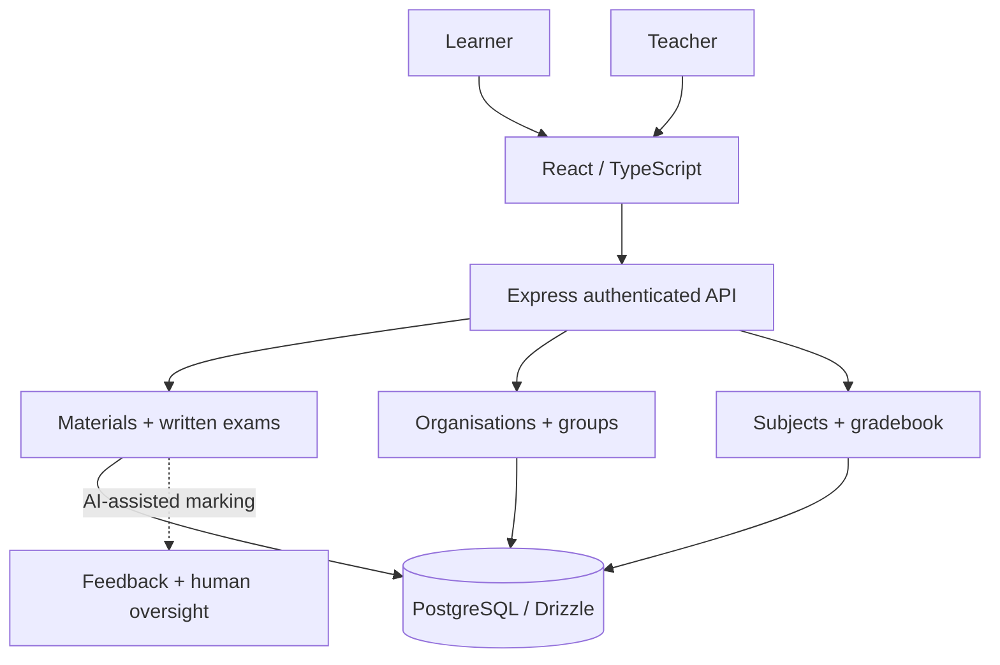
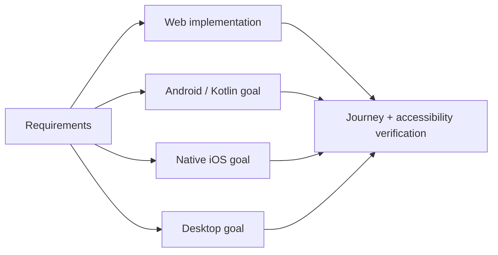

# CABO Learning Hub — Engineering Case Study

**Status:** Prototype and staged feature development. [Delivery register](PHASES_1_TO_4_DELIVERY_REGISTER.md) determines what is verified.

## Product question

How can learning content, assessment, institutional roles and learner progression be connected beyond a conventional LMS?

## Logical architecture

**Repository evidence:** Root `package.json` uses pnpm 10 and defines `pnpm run typecheck` and `pnpm run build`. The main README documents materials uploads, advisory written-exam marking, group assignments and academic workflows.

## Engineering decisions and boundaries

1. **Source-grounded assessments.** Questions and rubrics derive from uploaded materials. The README documents partial-credit grading and review flags. AI results are advisory, not official academic certification.
2. **Role separation.** Learner, educator and institutional scopes require distinct authorization checks. The README lists multi-account permission and tenant-isolation validation as rollout gates.
3. **Academic semantics.** Subjects, modules, periods and mark weights cannot assume universal NSC/IEB rules. Official qualification support has not been established.
4. **Cross-platform product direction.** Native Android/Kotlin, iOS and desktop parity are roadmap and validation goals, not shipped binaries.

## Cross-platform design roadmap

## Quality and visual evidence

| Item | Evidence or next validation |
|---|---|
| Build | `pnpm run typecheck && pnpm run build` is defined; not run in this documentation pass |
| Architecture | [Platform identity](PLATFORM_IDENTITY.md) |
| Release claims | [Phased delivery register](PHASES_1_TO_4_DELIVERY_REGISTER.md) |
| UI images | Capture synthetic learner/teacher screens, sanitise, then place in `docs/media/` |
| Charts | Add only measured, sourced assessment or usage data |

[Back to README](../README.md)
